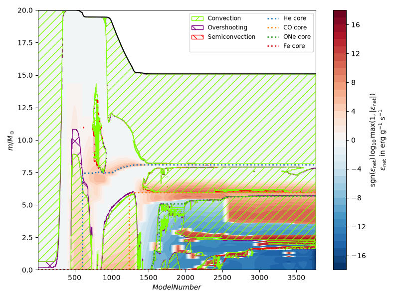
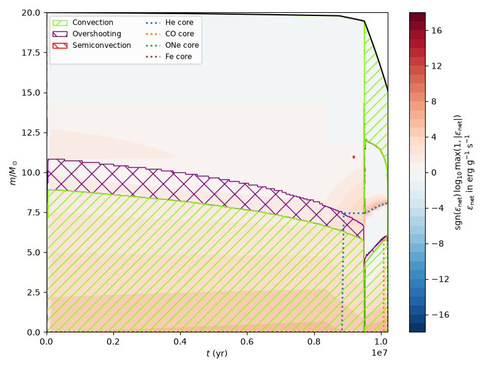
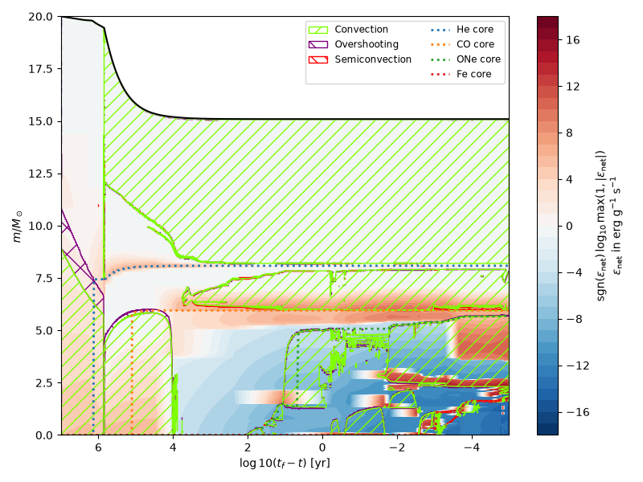
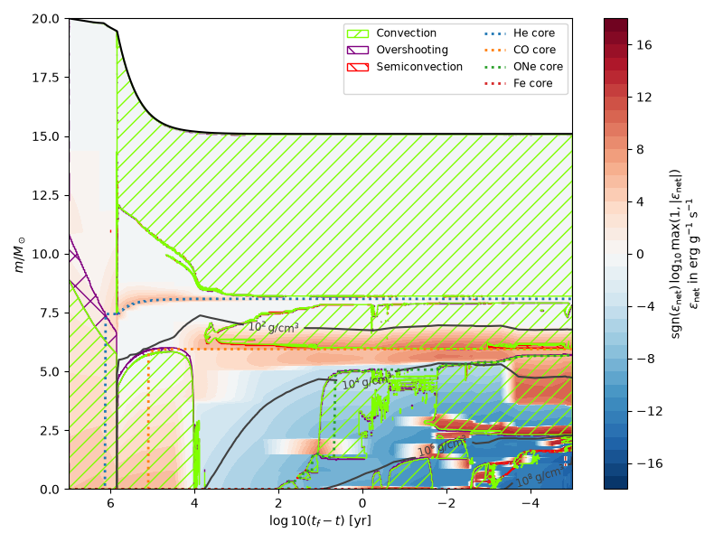
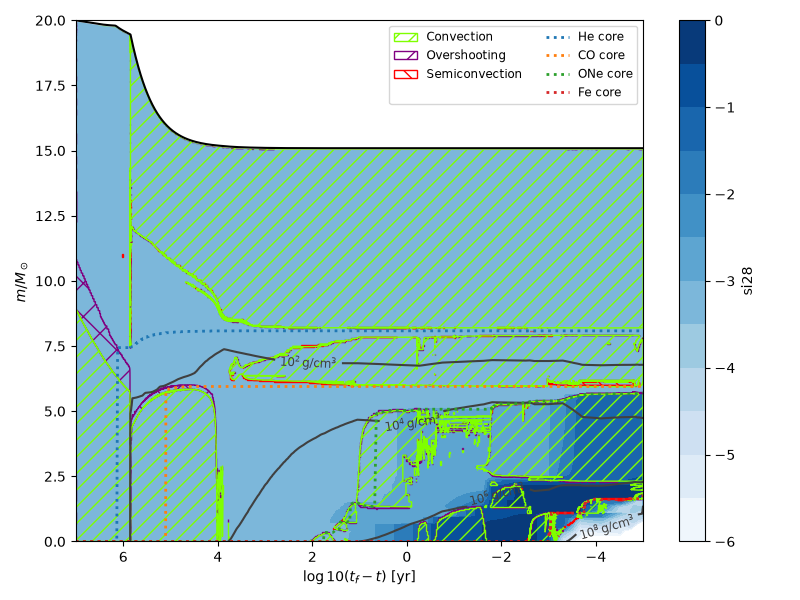
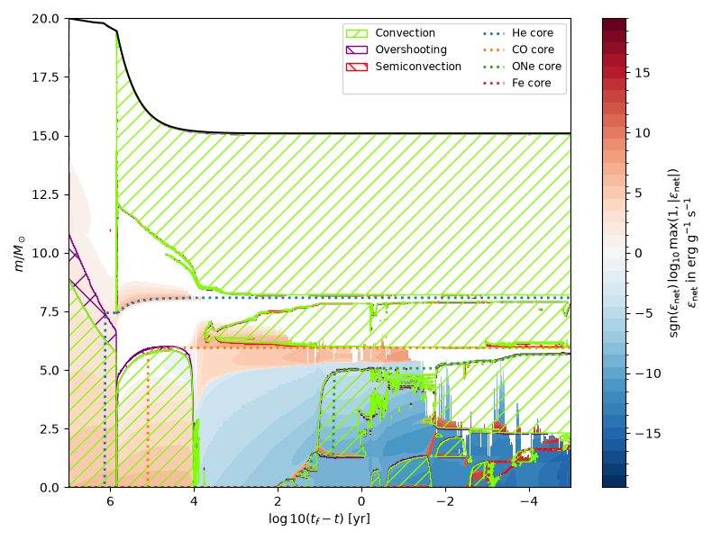
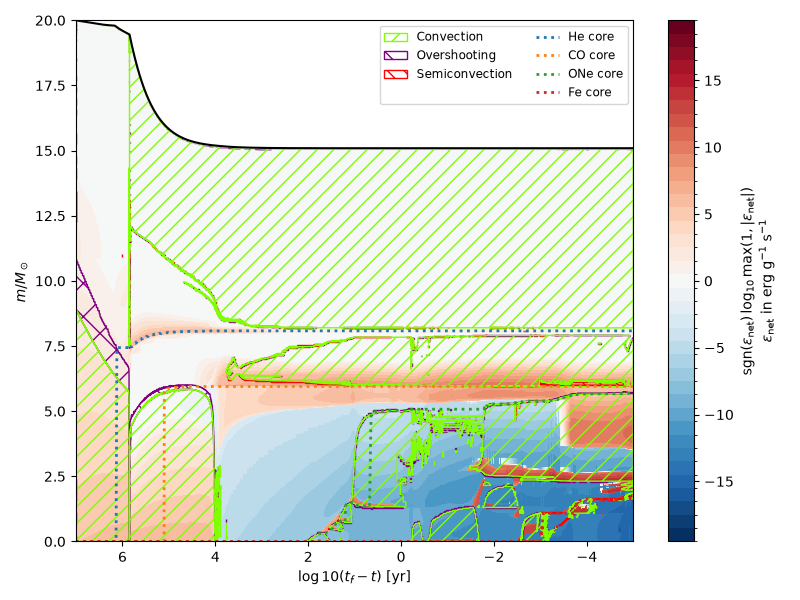
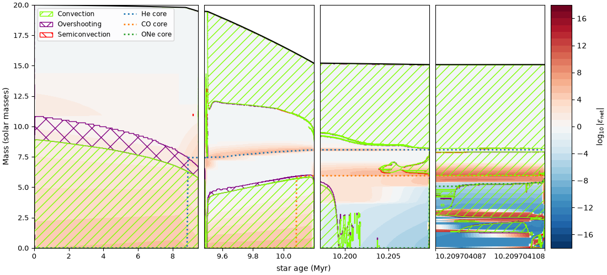

# `mkipp2`

Kippenhahn plotter for MESA.

> [!NOTE]
> This is a clean-up of the [mkipp](https://github.com/orlox/mkipp) project.
> See `CHANGES.md` for history.

> [!IMPORTANT]
> Your `history_columns.list` needs to have `mixing_regions` and
> `mix_relr_regions` specified for MESA to output the necessary data
> of the mixing regions in terms of mass and radius respectively.
>
> It is also recommended to have `burning_regions` set as well.
>
> When combining multiple history files, all files must have the same
> data column names (including unused columns). Column order may differ.


## Installation

From the repository root, install the library as:

```sh
python -m pip install .
```

and run the examples with:

```sh
cd example
python examples.py
```

## Basic design

The Kippenhahn plotter consists of 3 files:
- `mesa_data.py`: a simple parser of MESA data files that only parses
  specific columns to save time
- `kipp_data.py`: construct mixing-region boundaries
- `mkipp.py`: the Kippenhahn plotter

`KippenhahnDiagram` prepares profile and mixing data during
construction.  Its `plot()` method produces a decorated plot or draws
on a supplied Matplotlib axes object. The repository comes with some
sample MESA data for a 15 Msun star in
`example/LOGS-mesa-26.04.1.zip`.

The Python snippets below also assume `example/` is the working
directory, since the default MESA output is stored there (as
`LOGS-mesa-26.04.1.zip`).  For other data locations, pass
`logs_dirs=["path/to/LOGS"]` to `mkipp2.KippenhahnDiagram()`.

ZIP archives can be passed in the same way, without extracting them. For
example, from the repository root:

```python
import mkipp2

k = mkipp2.KippenhahnDiagram(
    logs_dirs=["example/LOGS-mesa-26.04.1.zip"],
    identifier="net_nuclear_energy", log10_on_data=False,
)
k.plot(core_masses=[])
```

Files may be at the archive root or inside a single LOGS folder
(including nested folders). If an archive contains multiple runs,
select one explicitly with
`logs_dirs=["runs.zip/path/to/LOGS"]`. Ordinary directories and ZIP
paths can be mixed in the same list. Headers and selected data columns
are streamed from the archive; no temporary files are extracted.

The lower-level readers also accept archive member paths, for example
`MesaData("run.zip/LOGS/history.data")`. `get_profile_paths(["run.zip"])`
returns member paths usable by `MesaData` and `KippenhahnDiagram`.

The examples below come directly from
[`example/examples.py`](example/examples.py). Each snippet includes its imports.


## Plots

### Basic plots

A simple plot of the net nuclear energy is done as:

```python
k = mkipp2.KippenhahnDiagram(logs_dirs=["LOGS-mesa-26.04.1.zip"],
                             identifier="net_nuclear_energy",
                             log10_on_data=False)
k.plot(core_masses=["He", "CO", "ONe", "Fe"],
       size=(8, 6),
       save_filename="Kipp-basic.png")
```

This results in the following plot


In this case, we are getting the mixing regions from the history file
(this relies on `mixing_regions` being set in your
`history_columns.list`---`40` is a good value) and the values of the
energy generation from the profiles.  As we'll see below, if `burning_regions`
are defined, we can make an analogous plot.


We can instead plot in terms of stellar age:

```python
k = mkipp2.KippenhahnDiagram(logs_dirs=["LOGS-mesa-26.04.1.zip"],
                             xaxis="star_age",
                             time_units="yr",
                             identifier="net_nuclear_energy",
                             log10_on_data=False)
k.plot(core_masses=["He", "CO", "ONe", "Fe"],
       size=(8, 6),
       save_filename="Kipp-age.png")
```

This results in the following plot



### Time to collapse

For massive stars evolved toward collapse, we can set the x-axis to
`collapse` to get a plot that is time until collapse:

```python
k = mkipp2.KippenhahnDiagram(logs_dirs=["LOGS-mesa-26.04.1.zip"],
                             xaxis="collapse",
                             time_units="yr",
                             identifier="net_nuclear_energy",
                             log10_on_data=False)

k.plot(core_masses=["He", "CO", "ONe", "Fe"],
       size=(8, 6),
       save_filename="Kipp-collapse.png")
```

This results in the following plot


We can also add contours of density:

```python
k = mkipp2.KippenhahnDiagram(logs_dirs=["LOGS-mesa-26.04.1.zip"],
                             xaxis="collapse",
                             time_units="yr",
                             identifier="net_nuclear_energy",
                             log10_on_data=False)

k.plot(core_masses=["He", "CO", "ONe", "Fe"],
       density_contours=[1.e2, 1.e4, 1.e6, 1.e8],
       size=(8, 6),
       save_filename="Kipp-collapse-density.png")
```

giving



### Other fields

Any quantity in the profiles can be visualized.  Here we look at the
silicon mass fraction:

```python
k = mkipp2.KippenhahnDiagram(logs_dirs=["LOGS-mesa-26.04.1.zip"],
                             xaxis="collapse",
                             time_units="yr",
                             identifier="si28",
                             log10_on_data=True)

k.plot(core_masses=["He", "CO", "ONe", "Fe"],
       density_contours=[1.e2, 1.e4, 1.e6, 1.e8],
       size=(8, 6),
       levels=np.arange(-6, 0.5, 0.5),
       save_filename="Kipp-si.png")
```

giving



### Burning regions

If your `history-columns.list` has `burning_regions` set, then
you can visualize the net energy from that.  This likely has higher temporal resolution
(since a line in history is output typically every step vs. 50-100 steps between profiles).

The burning regions uses a different plot method:

```python
k = mkipp2.KippenhahnDiagram(logs_dirs=["LOGS-mesa-26.04.1.zip"],
                             xaxis="collapse",
                             time_units="yr",
                             load_profiles=False)

k.plot_burning_regions(core_masses=["He", "CO", "ONe", "Fe"],
                       size=(8, 6),
                       save_filename="Kipp-burning_regions.png")
```

giving



> [!IMPORTANT]
> If `burning_regions` is set too small, then some of the burning regions
> will not show.  For the example data here, we used `burning_regions =
> 20`, but a value of `40` or `80` is better.

To fill in burning regions missing from the history output, use
`hybrid_mode=True`. Load profiles with `identifier="net_nuclear_energy"`:

```python
k = mkipp2.KippenhahnDiagram(logs_dirs=["LOGS-mesa-26.04.1.zip"],
                             xaxis="collapse", time_units="yr",
                             identifier="net_nuclear_energy")
k.plot_burning_regions(hybrid_mode=True, size=(8, 6),
                       save_filename="Kipp-burning_regions-hybrid.png")
```

This draws profile contours first, then opaque history regions above them.
Zero and unused history regions leave the profiles visible. Both layers use
the same color scale, with automatic bins spanning both data sources.  This
results in the following plot:




### Advanced plotting

You can setup the figure and axes yourself and split the data into multiple views.
Here's a split view of the evolution that breaks at H, He, and O core depletion.
See the `examples.py` for the script.


